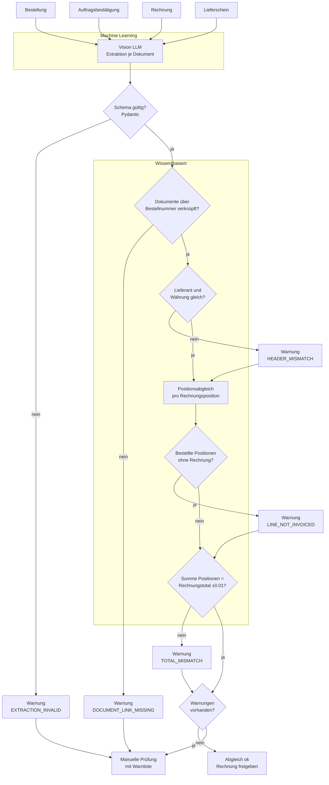
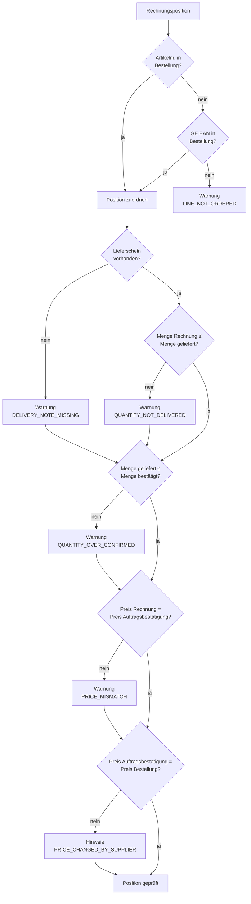

# Modell Dokumentenabgleich (Soll)

Abgleich von **Bestellung**, **Auftragsbestätigung**, **Rechnung** und
**Lieferschein** (was tatsächlich angekommen ist). Gleiches Prinzip wie bei der
Verzollung: Das ML **liest**, die Regeln **entscheiden**.

> Annahme: Die gelieferte Menge kommt aus dem Lieferschein bzw. der
> Wareneingangsmeldung. Fehlt dieses Dokument, wird die Mengenprüfung
> gegen die Lieferung übersprungen und als Warnung gemeldet.

## Gesamtablauf

## Positionsabgleich (pro Rechnungsposition)

## Regeln

| Regel | Vergleich | Code bei Abweichung |
|---|---|---|
| Verknüpfung | Bestellnummer auf Auftragsbestätigung, Rechnung und Lieferschein | `DOCUMENT_LINK_MISSING` |
| Kopfdaten | Lieferant und Währung auf allen Dokumenten gleich | `HEADER_MISMATCH` |
| Zuordnung | Artikelnummer zuerst, GE EAN als Fallback (wie Verzollung) | `LINE_NOT_ORDERED` |
| Lieferung | Verrechnete Menge ≤ gelieferte Menge | `QUANTITY_NOT_DELIVERED` |
| Bestätigung | Gelieferte Menge ≤ bestätigte Menge | `QUANTITY_OVER_CONFIRMED` |
| Preis | Rechnung gegen Auftragsbestätigung (verbindlicher Preis) | `PRICE_MISMATCH` |
| Preisänderung | Auftragsbestätigung gegen Bestellung (nur Hinweis) | `PRICE_CHANGED_BY_SUPPLIER` |
| Offene Positionen | Bestellt, aber nicht verrechnet (Teillieferung) | `LINE_NOT_INVOICED` |
| Total | Summe der Positionen = Rechnungstotal, Toleranz ±0.01 | `TOTAL_MISMATCH` |

Toleranzen (Preis, Total) sind Parameter und werden in den Stammdaten
gepflegt, nicht im Code.

## Offene Punkte

- Lieferschein bestätigen oder durch anderes Dokument ersetzen, sobald die
  Trainingsdaten vorliegen.
- Felder des Datenmodells (`models.py`) für Bestellung, Auftragsbestätigung
  und Lieferschein aus den Beispieldokumenten ableiten.
- Klären, ob Teillieferungen erlaubt sind oder immer eine Warnung auslösen.
