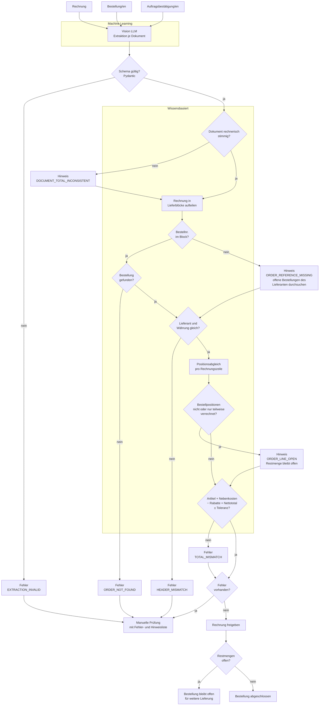
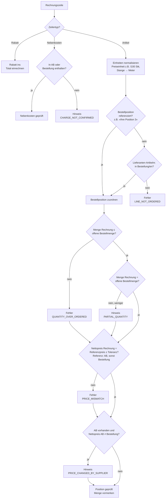

# Modell Dokumentenabgleich (Soll)
 
Abgleich von **Bestellung**, **Auftragsbestätigung** und **Rechnung**.
Gleiches Prinzip wie bei der Verzollung: Das ML **liest**, die Regeln
**entscheiden**.
 
> Es gibt keinen Lieferschein. Was angekommen ist, ergibt sich aus der
> Rechnung: Der Lieferant verrechnet, was er geliefert hat.
 
## Grundregel
 
**Jeder Artikel auf der Rechnung muss bestellt worden sein.**
Umgekehrt gilt das nicht: Nicht alles, was bestellt wurde, muss auf dieser
Rechnung stehen. Nebenkosten (Porto, Fracht, Verpackung, Zuschläge) und
Rabattzeilen sind keine Artikel und werden separat geprüft.
 
| Fall | Beispiel | Bewertung |
|---|---|---|
| Vollständige Lieferung | Bestellt 10 A, 5 B – verrechnet 10 A, 5 B | ok |
| Artikel fehlt | Bestellt 10 A, 5 B – verrechnet nur 10 A (B nicht geliefert) | Hinweis, B bleibt offen |
| Teilmenge | Bestellt 10 A – geliefert und verrechnet 6 A | Hinweis, 4 A bleiben offen |
| Sammelrechnung | Eine Rechnung, mehrere Lieferblöcke mit je eigener Bestellnummer | ok, wenn jede Artikelzeile einer Bestellung zugeordnet werden kann |
| Block ohne Bestellnummer | Lieferblock nennt nur eine Kontaktperson | Hinweis, Suche über Artikelnummer in offenen Bestellungen |
| Nebenkosten | Porto, Fracht, Verpackung, Transportzuschlag | ok, wenn in AB oder Bestellung enthalten, sonst Hinweis |
| Rundungsdifferenz | Nettopreis 29.37 bestellt, 29.35 verrechnet | ok innerhalb Toleranz |
| Nicht bestellt | Rechnung enthält Artikel C, der in keiner Bestellung vorkommt | **Fehler** |
| Zu viel verrechnet | Bestellt 10 A – verrechnet 12 A | **Fehler** |
| Preis abweichend | Nettopreis ausserhalb der Toleranz | **Fehler** |
 
**Fehler** blockieren die Freigabe und führen zur manuellen Prüfung.
**Hinweise** werden angezeigt, blockieren aber nicht.
 
## Gesamtablauf
 

 
## Positionsabgleich (pro Rechnungszeile)
 

 
## Regeln
 
| Regel | Vergleich | Code | Stufe |
|---|---|---|---|
| Rechnerische Prüfung | Positionen + Nebenkosten + MwSt = Total auf jedem Dokument | `DOCUMENT_TOTAL_INCONSISTENT` | Hinweis |
| Verknüpfung | Bestellnummer pro Lieferblock existiert | `ORDER_NOT_FOUND` | Fehler |
| Fehlende Referenz | Lieferblock ohne Bestellnummer, Suche über Artikelnummer in offenen Bestellungen des Lieferanten | `ORDER_REFERENCE_MISSING` | Hinweis |
| Kopfdaten | Lieferant und Währung auf allen Dokumenten gleich | `HEADER_MISMATCH` | Fehler |
| Zeilentyp | Artikel, Nebenkosten oder Rabatt (über Artikelnummer oder Bezeichnung, z.B. Porto, Fracht, Verpackung, Zuschlag) | – | – |
| Bestellt | Jede Artikelzeile gehört zu einer Bestellposition: Positionsreferenz zuerst, sonst Lieferanten-Artikelnummer | `LINE_NOT_ORDERED` | Fehler |
| Nebenkosten | Nebenkosten sind in AB oder Bestellung enthalten | `CHARGE_NOT_CONFIRMED` | Hinweis |
| Einheiten | Mengen und Preise vor dem Vergleich auf gleiche Einheit bringen (Preiseinheit, Verpackungseinheit, Stange/Meter) | – | – |
| Übermenge | Verrechnete Menge ≤ offene Bestellmenge | `QUANTITY_OVER_ORDERED` | Fehler |
| Teilmenge | Verrechnete Menge < offene Bestellmenge | `PARTIAL_QUANTITY` | Hinweis |
| Preis | Nettopreis pro Einheit gegen AB (sonst Bestellung), mit Toleranz | `PRICE_MISMATCH` | Fehler |
| Preisänderung | Nettopreis AB gegen Bestellung | `PRICE_CHANGED_BY_SUPPLIER` | Hinweis |
| Offene Positionen | Bestellt, aber (noch) nicht oder nur teilweise verrechnet | `ORDER_LINE_OPEN` | Hinweis |
| Total | Artikel + Nebenkosten − Rabatte = Nettototal der Rechnung, mit Toleranz | `TOTAL_MISMATCH` | Fehler |
 
**Offene Bestellmenge** = bestätigte Menge (laut Auftragsbestätigung, sonst
Bestellmenge) − bereits auf früheren Rechnungen verrechnete Menge.
Damit funktionieren auch mehrere Teilrechnungen zur selben Bestellung:
Erst bei der Freigabe bucht eine Rechnung ihre vorgemerkten Mengen auf die
Bestellpositionen, bis die Restmenge 0 ist.
 
**Preise** werden als Nettopreis pro Einheit verglichen (Listenpreis minus
Rabatt), nicht als Zeilenbetrag: Bei Teilmengen unterscheiden sich die
Zeilenbeträge, der Einheitspreis bleibt gleich. Lieferanten runden
unterschiedlich (Einheitspreis oder Zeilenbetrag), deshalb braucht der
Vergleich eine Toleranz.
 
Toleranzen (Preis, Total) sind Parameter und werden in den Stammdaten
gepflegt, nicht im Code.
 
## Beobachtungen aus den Trainingsdaten
 
Stichprobe: 5 Lieferanten, 6 Bestellungen, 5 Auftragsbestätigungen,
5 Rechnungen. Lieferanten anonymisiert (A–E).
 
| Beobachtung | Lieferant | Folge fürs Modell |
|---|---|---|
| Bestellnummer steht pro Lieferblock, nicht im Rechnungskopf | alle | Rechnung in Lieferblöcke aufteilen |
| Sammelrechnung mit 2, 9 bzw. ca. 40 Bestellungen | A, B, C | Mehrere Bestellungen pro Rechnung sind der Normalfall |
| Lieferblöcke ohne Bestellnummer, nur Kontaktperson | C | `ORDER_REFERENCE_MISSING`, Suche über Artikelnummer |
| Rechnung referenziert die Bestellposition («Ihre Position 3») | B | Positionsreferenz vor Artikelnummer verwenden |
| Rechnung zeigt «bestellt / geliefert» pro Zeile und verrechnet die gelieferte Menge | C | Teilmenge direkt ablesbar |
| Bestellposition später geliefert (Terminänderung in der AB) | B | Teillieferung, Position bleibt offen |
| Eigene Artikelnummer = Lieferantenpräfix + Lieferanten-Artikelnummer | Bestellungen | Abgleich über Lieferanten-Artikelnummer |
| Porto, Fracht, Verpackung, Transportzuschlag nur auf AB/Rechnung | A, D, E | Nebenkosten als eigener Zeilentyp |
| Rabattzeilen mit negativem Betrag, Versand «kostenlos» | C | Rabatt als eigener Zeilentyp |
| Preis pro 100 Stück | C, E | Preiseinheit normalisieren |
| Bestellt in Meter, verrechnet als Stange à 6 m | A | Einheiten normalisieren |
| Rundungsdifferenzen von 0.01–0.05 im Nettopreis | A, B | Toleranz nötig |
| Artikel auf AB und Rechnung, aber nicht auf der Bestellung | E | Echter Fall für `LINE_NOT_ORDERED` |
| Nettopreis auf AB/Rechnung höher bzw. tiefer als bestellt | A, E | Echte Fälle für `PRICE_MISMATCH` / `PRICE_CHANGED_BY_SUPPLIER` |
| AB rechnerisch nicht stimmig (MwSt-Basis ≠ Total) | D | `DOCUMENT_TOTAL_INCONSISTENT` |
 
## Offene Punkte
 
- Felder des Datenmodells (`models.py`) für Bestellung und
  Auftragsbestätigung ableiten, inkl. Lieferblock, Zeilentyp und
  Positionsreferenz.
- Für viele Lieferblöcke in den Sammelrechnungen fehlt die Bestellung in der
  Stichprobe – im Betrieb kommen die Bestellungen aus dem ERP.
- Toleranz festlegen (absolut pro Einheit oder relativ in %).
- Liste der Nebenkosten-Artikelnummern pro Lieferant pflegen.
- Klären, ob Nebenkosten ohne AB nur ein Hinweis sind oder ab einem
  Betrag blockieren.
- Klären, ab wann eine offene Restmenge als Warnung gilt (z.B. nach X Tagen
  ohne Lieferung).
