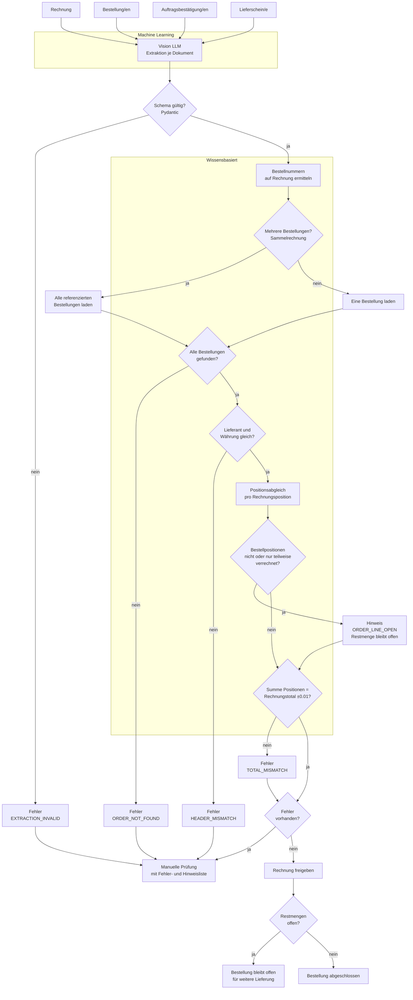
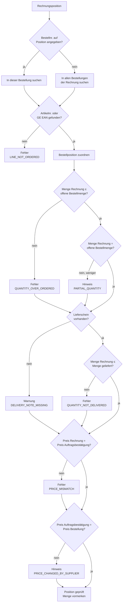

# Modell Dokumentenabgleich (Soll)

Abgleich von **Bestellung**, **Auftragsbestätigung**, **Rechnung** und
**Lieferschein** (was tatsächlich angekommen ist). Gleiches Prinzip wie bei der
Verzollung: Das ML **liest**, die Regeln **entscheiden**.

> Annahme: Die gelieferte Menge kommt aus dem Lieferschein bzw. der
> Wareneingangsmeldung. Fehlt dieses Dokument, wird die Mengenprüfung
> gegen die Lieferung übersprungen und als Warnung gemeldet.

## Grundregel

**Alles, was auf der Rechnung steht, muss bestellt worden sein.**
Umgekehrt gilt das nicht: Nicht alles, was bestellt wurde, muss auf dieser
Rechnung stehen.

| Fall | Beispiel | Bewertung |
|---|---|---|
| Vollständige Lieferung | Bestellt 10 A, 5 B – verrechnet 10 A, 5 B | ok |
| Artikel fehlt | Bestellt 10 A, 5 B – verrechnet nur 10 A (B nicht geliefert) | Hinweis, B bleibt offen |
| Teilmenge | Bestellt 10 A – geliefert und verrechnet 6 A | Hinweis, 4 A bleiben offen |
| Sammelrechnung | Rechnung enthält Bestellung 1 **und** Artikel aus Bestellung 2 | ok, wenn jede Position einer Bestellung zugeordnet werden kann |
| Nicht bestellt | Rechnung enthält Artikel C, der in keiner Bestellung vorkommt | **Fehler** |
| Zu viel verrechnet | Bestellt 10 A – verrechnet 12 A | **Fehler** |

**Fehler** blockieren die Freigabe und führen zur manuellen Prüfung.
**Hinweise** werden angezeigt, blockieren aber nicht.

## Gesamtablauf

## Positionsabgleich (pro Rechnungsposition)

## Regeln

| Regel | Vergleich | Code | Stufe |
|---|---|---|---|
| Verknüpfung | Jede Bestellnummer auf der Rechnung existiert | `ORDER_NOT_FOUND` | Fehler |
| Kopfdaten | Lieferant und Währung auf allen Dokumenten gleich | `HEADER_MISMATCH` | Fehler |
| Bestellt | Jede Rechnungsposition gehört zu einer Bestellposition (Artikelnr. zuerst, GE EAN als Fallback, bei Sammelrechnung über alle Bestellungen) | `LINE_NOT_ORDERED` | Fehler |
| Übermenge | Verrechnete Menge ≤ offene Bestellmenge | `QUANTITY_OVER_ORDERED` | Fehler |
| Teilmenge | Verrechnete Menge < offene Bestellmenge | `PARTIAL_QUANTITY` | Hinweis |
| Lieferung | Verrechnete Menge ≤ gelieferte Menge | `QUANTITY_NOT_DELIVERED` | Fehler |
| Lieferschein | Lieferschein fehlt, Lieferprüfung übersprungen | `DELIVERY_NOTE_MISSING` | Warnung |
| Preis | Rechnung gegen Auftragsbestätigung (verbindlicher Preis) | `PRICE_MISMATCH` | Fehler |
| Preisänderung | Auftragsbestätigung gegen Bestellung | `PRICE_CHANGED_BY_SUPPLIER` | Hinweis |
| Offene Positionen | Bestellt, aber (noch) nicht oder nur teilweise verrechnet | `ORDER_LINE_OPEN` | Hinweis |
| Total | Summe der Positionen = Rechnungstotal, Toleranz ±0.01 | `TOTAL_MISMATCH` | Fehler |

**Offene Bestellmenge** = bestätigte Menge (laut Auftragsbestätigung, sonst
Bestellmenge) − bereits auf früheren Rechnungen verrechnete Menge.
Damit funktionieren auch mehrere Teilrechnungen zur selben Bestellung:
Erst bei der Freigabe bucht eine Rechnung ihre vorgemerkten Mengen auf die
Bestellpositionen,
bis die Restmenge 0 ist.

Toleranzen (Preis, Total) sind Parameter und werden in den Stammdaten
gepflegt, nicht im Code.

## Offene Punkte

- Lieferschein bestätigen oder durch anderes Dokument ersetzen, sobald die
  Trainingsdaten vorliegen.
- Felder des Datenmodells (`models.py`) für Bestellung, Auftragsbestätigung
  und Lieferschein aus den Beispieldokumenten ableiten.
- Prüfen, ob Sammelrechnungen die Bestellnummer pro Position angeben oder
  nur im Kopf.
- Klären, ab wann eine offene Restmenge als Warnung gilt (z.B. nach X Tagen
  ohne Lieferung).
